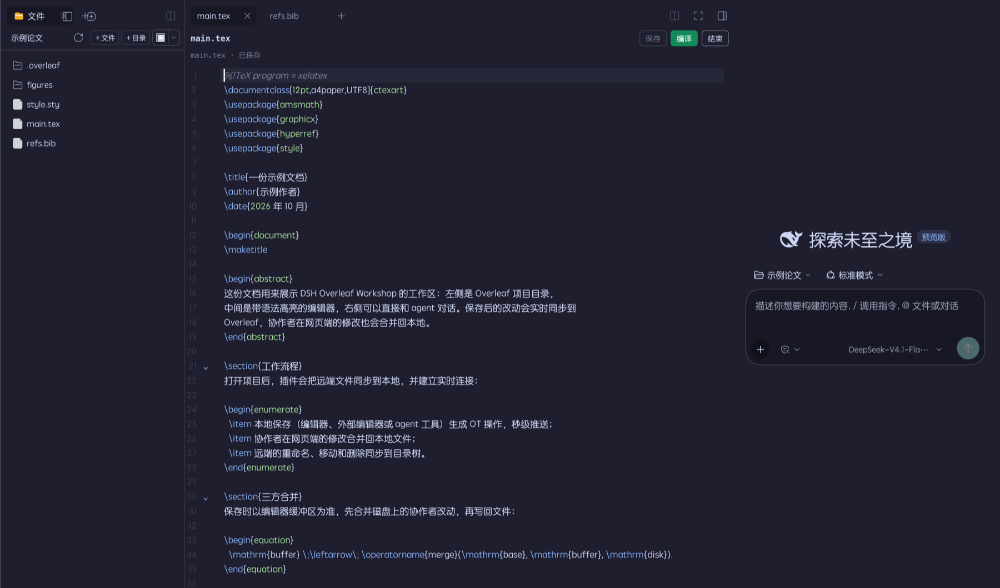

# DeepSeek Harness · Overleaf Workshop

在 DeepSeek Harness 中直接编辑 Overleaf 项目，实时双向同步。



*界面示意（示例项目）：左侧 Overleaf 目录，中间带高亮与自动保存的编辑器，右侧直接和 Agent 对话。*

## 功能

- **实时双向同步**：本地编辑、Agent 修改会自动推送到 Overleaf，网页端的协作修改也会同步回本地。支持文件新建、重命名、移动和删除，以及并发编辑时的三方合并。
- **三栏编辑界面**：目录树、文件编辑器、Agent 对话并排显示。内置 CodeMirror 6 编辑器，支持 LaTeX 语法高亮、搜索、自动保存和快捷键操作。
- **LaTeX 编辑增强**：支持环境和章节折叠、括号匹配、`Ctrl/Cmd-Space` 补全；会从项目源码建立索引，补全 `\begin`/`\end` 环境、`\cite` 文献键、`\ref` 标签、`\input`/`\includegraphics` 路径和常用命令，并提供章节大纲。
- **大项目与异常恢复**：项目文件列表只渲染当前可视区域；同一工作区的打开文件共享批量变更轮询；编辑中的内容会在浏览器本地保留恢复草稿，Harness 异常退出后可选择恢复或丢弃。
- **在线编译与 PDF 预览**：在 Overleaf 服务器上编译当前打开的 `.tex` 文件，生成的 `output.pdf` 可以直接在内置预览中查看。
- **项目与会话管理**：侧边栏独立显示 Overleaf 项目及同步状态，支持快速编译、新建会话、切换历史会话和结束同步。
- **文件树快捷创建**：在文件树中右键项目空白处、目录或文件，可直接在对应位置新建文件或文件夹；新建文件会自动打开到编辑器。
- **按需同步**：可以随时停止实时连接，保留全部本地文件；重新进入项目即可恢复同步。实时连接不可用时，也支持手动拉取和推送。

## 安装

推荐通过 GitHub 安装：

```bash
dsh plugin --profile desktop add github:chenqaq123/dsh-overleaf-workshop
```

macOS 桌面版如果找不到 `dsh` 命令，可以使用应用内自带的 CLI：

```bash
"/Applications/DeepSeek Harness.app/Contents/Resources/runtime/cli/bin/dsh" plugin --profile desktop add github:chenqaq123/dsh-overleaf-workshop
```

安装完成后重启 Harness，在「插件 → 已安装」中管理插件。

## 登录与使用

1. 在浏览器中登录 Overleaf。
2. 按 `F12` 打开开发者工具，在 **Network** 中找到任意请求，复制请求头里的 `Cookie` 值。
3. 打开 Harness 侧边栏的 **Overleaf → 管理**，粘贴 Cookie，点击「验证并登录」。
4. 选择项目，即可进入本地工作区。

Cookie 仅保存在本机 `~/.dsh/overleaf/secrets.json`。

进入项目后，可以直接编辑文件，也可以让 Agent 完成任务，例如：

## 许可证

[MIT](LICENSE)

本项目未使用 Overleaf Workshop（AGPL-3.0）的代码，相关协议实现基于独立研究。
