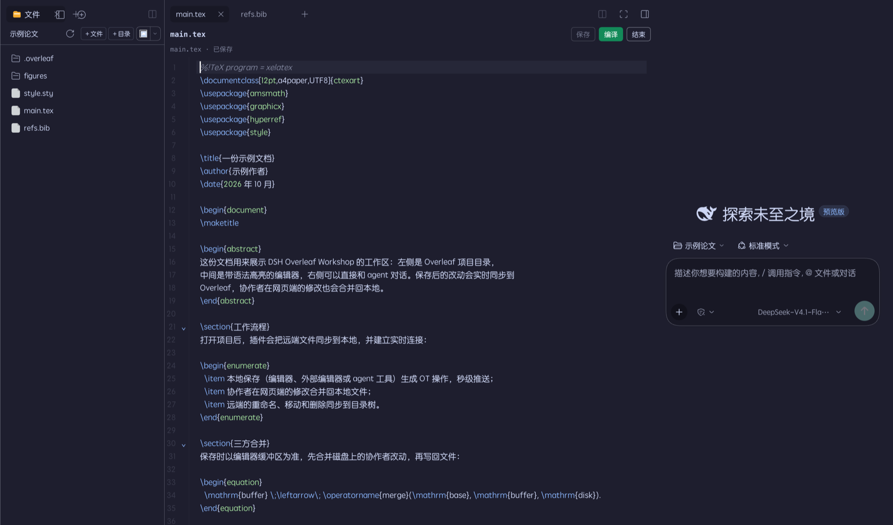

# DeepSeek Harness · Overleaf Workshop

在 DeepSeek Harness 中直接编辑 Overleaf 项目，实时双向同步。



*界面示意（示例项目）：左侧 Overleaf 目录，中间带高亮与自动保存的编辑器，右侧直接和 Agent 对话。*

## 功能

- **实时双向同步**：打开或切换 Overleaf 会话时自动连接。启动时先拉取云端文件树与内容，再上传仅存在于本地一侧的改动；两边都修改过的文件会把本地稿保存在 `.overleaf/conflicts/` 后载入云端版本，避免静默覆盖。支持文件新建、重命名、移动和删除，以及在线并发编辑时的三方合并。
- **三栏编辑界面**：目录树、文件编辑器、Agent 对话并排显示。内置 CodeMirror 6 编辑器，支持 LaTeX 语法高亮、搜索、自动保存和快捷键操作。
- **LaTeX 编辑增强**：支持环境和章节折叠、括号匹配、`Ctrl/Cmd-Space` 补全；会从项目源码建立索引，补全 `\begin`/`\end` 环境、`\cite` 文献键、`\ref` 标签、`\input`/`\includegraphics` 路径和常用命令，并提供章节大纲。
- **大项目与异常恢复**：项目文件列表只渲染当前可视区域；同一工作区的打开文件共享批量变更轮询；编辑中的内容会在浏览器本地保留恢复草稿，Harness 异常退出后可选择恢复或丢弃。
- **在线编译与 PDF 预览**：在 Overleaf 服务器上编译当前打开的 `.tex` 文件，生成的 `output.pdf` 可以直接在内置预览中查看。
- **项目与会话管理**：侧边栏按本地工作区展示论文，每个工作区下直接列出独立的对话记录；不同对话共用同一份论文文件和同步连接。
- **原生风格会话操作**：点击工作区仅展开或收起会话，点击会话才打开论文编辑区。会话悬浮菜单复用 Harness 的重命名和归档；「删除会话」经确认后归档并从 Overleaf 列表移除，保留 Harness 历史日志和论文文件。
- **文件树快捷创建**：在文件树中右键项目空白处、目录或文件，可直接在对应位置新建文件或文件夹；新建文件会自动打开到编辑器。
- **静默后台同步**：正常的连接、重连和待推送状态不占用界面；只在登录失效、同步冲突或需要用户处理时提示。需要排障时仍可从工作区菜单断开或恢复同步，也支持手动拉取和推送。

## 安装

推荐通过 GitHub 安装：

```bash
dsh plugin --profile desktop add github:chenqaq123/dsh-overleaf-workshop
```

macOS 桌面版如果找不到 `dsh` 命令，可以使用应用内自带的 CLI：

```bash
"/Applications/DeepSeek Harness.app/Contents/Resources/runtime/cli/bin/dsh" plugin --profile desktop add github:chenqaq123/dsh-overleaf-workshop
```

Windows 桌面版同理：

```powershell
& "$env:LOCALAPPDATA\Programs\DeepSeek Harness\resources\runtime\cli\bin\dsh.cmd" plugin --profile desktop add github:chenqaq123/dsh-overleaf-workshop
```

安装完成后重启 Harness，在「插件 → 已安装」中管理插件。

支持 macOS、Linux 和 Windows。插件只做本地文件操作与 Overleaf 服务器通信，对本地系统没有额外要求。

## 登录与使用

1. 在浏览器中登录 Overleaf。
2. 按 `F12` 打开开发者工具，在 **Network** 中找到任意请求，复制请求头里的 `Cookie` 值。
3. 打开 Harness 侧边栏的 **Overleaf → 管理**，粘贴 Cookie，点击「验证并登录」。
4. 从已有项目中选择论文，点击「创建本地工作区」。随后这就是一个普通的本地论文目录。
5. 在工作区下新建或切换对话。每个对话有独立的消息记录，但共用同一份论文目录和同一条实时连接；打开会话时会自动核验云端最新版本并开始同步。

Cookie 仅保存在本机 `~/.dsh/overleaf/secrets.json`。

进入项目后，可以直接编辑文件，也可以让 Agent 完成任务，例如：

## 许可证

[MIT](LICENSE)

本项目未使用 Overleaf Workshop（AGPL-3.0）的代码，相关协议实现基于独立研究。
